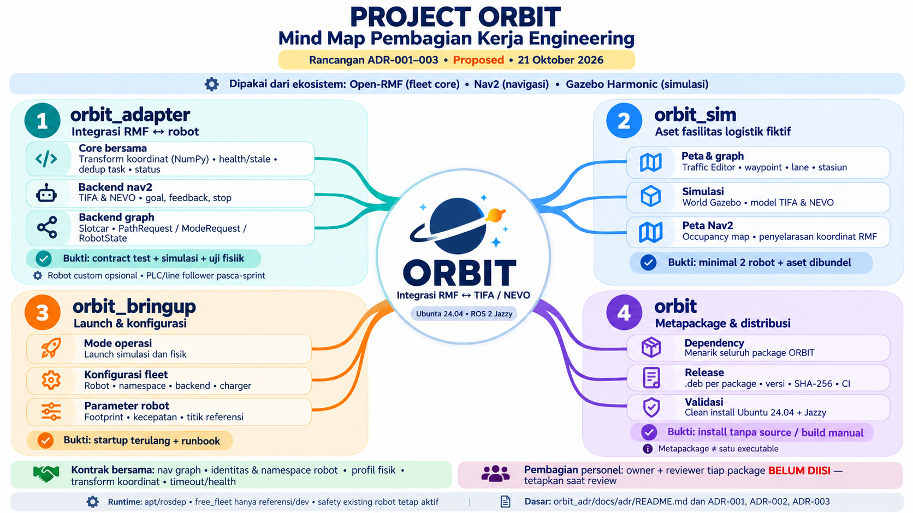

# Architecture Decision Records

| ADR | Judul | Status |
| --- | --- | --- |
| [ADR-001](ADR-001-open-rmf-sebagai-fleet-core.md) | Open-RMF sebagai fleet core ORBIT | Proposed |
| [ADR-002](ADR-002-orbit-adapter-backend-nav2-dan-graph.md) | `orbit_adapter` dengan dua backend navigasi (`nav2` dan `graph`) | Proposed |
| [ADR-003](ADR-003-struktur-package-dan-binary-release.md) | Struktur package dan batas dependency untuk binary release | Proposed |
| [ADR-004](ADR-004-batas-orbit-bringup-dan-robot-bringup.md) | Batas `orbit_bringup` dan bringup robot (`tifa_bringup`, `nevo_bringup`) | Proposed |
| [ADR-005](ADR-005-rmw-cyclone-dds.md) | Cyclone DDS sebagai RMW ORBIT | Proposed |

Format mengikuti [templates/ADR.md](../../templates/ADR.md). Status berubah menjadi **Accepted** setelah direview oleh orang selain owner.

## Mind map pembagian kerja

[Unduh mind map 16:9](../assets/ORBIT-mindmap-pembagian-package-v1.png).

Diagram mengikuti ADR-001–003 yang masih **Proposed**. Pembagian berdasarkan tanggung jawab package; nama owner dan reviewer belum ditetapkan. Label bukti menjelaskan target verifikasi, bukan hasil tes yang sudah lulus.
